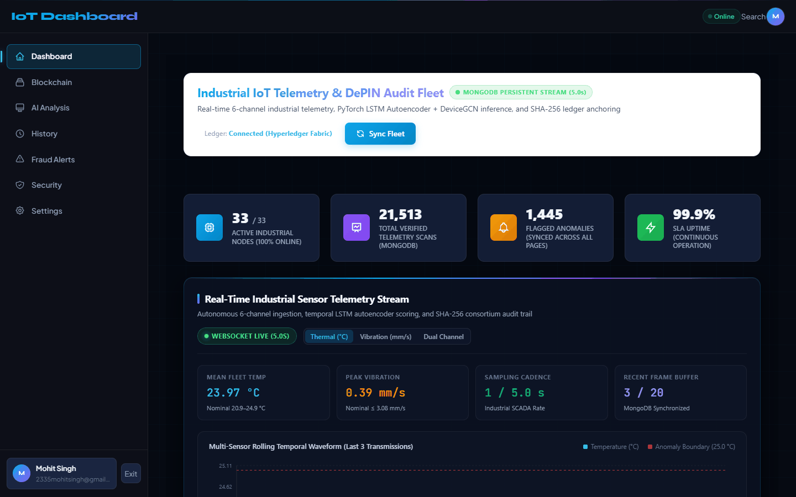
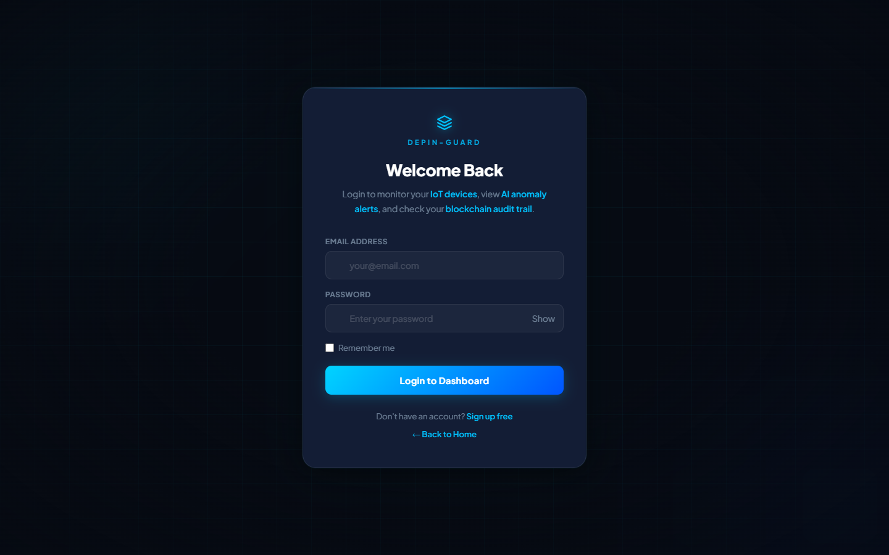
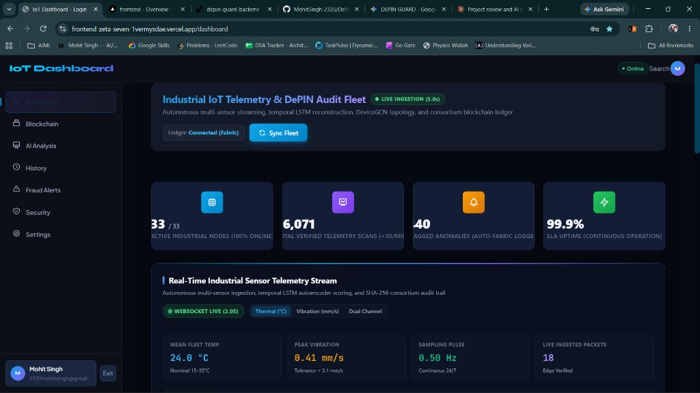
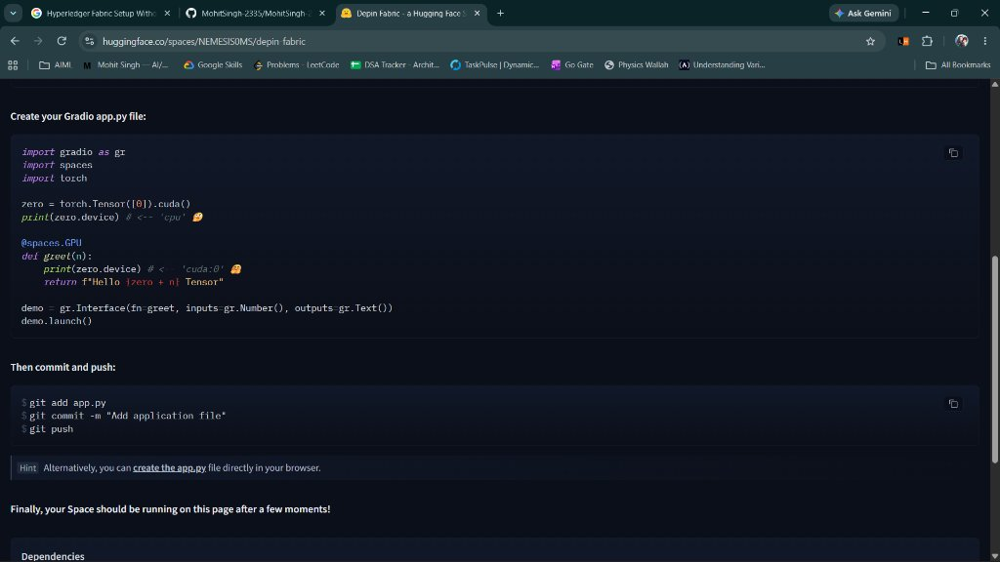
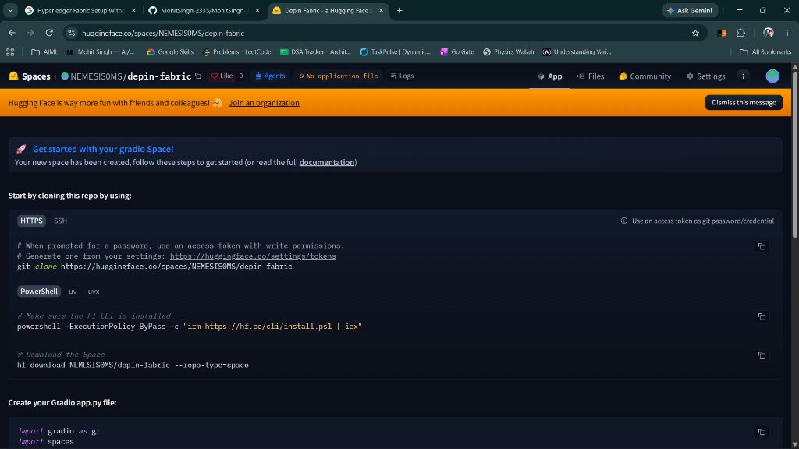
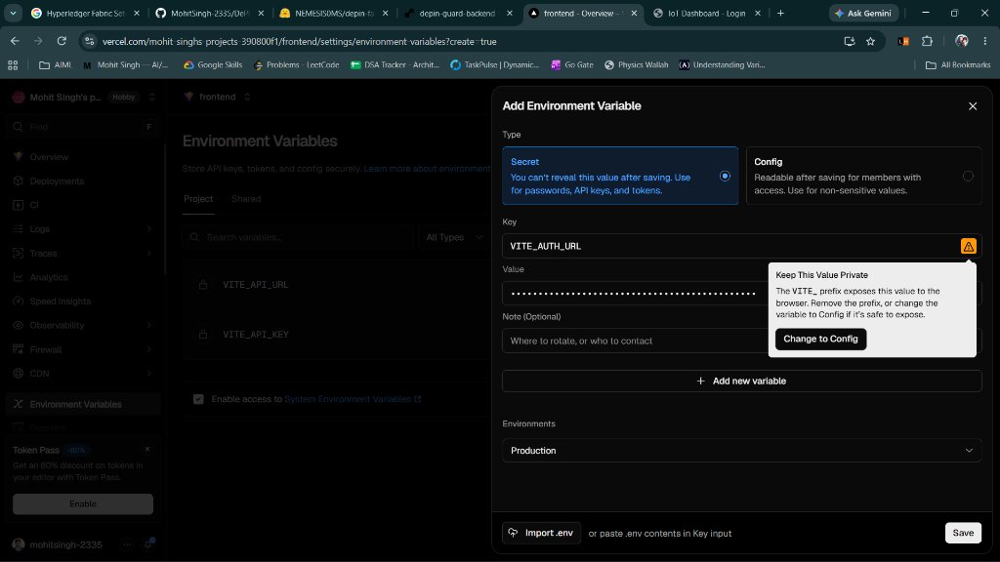
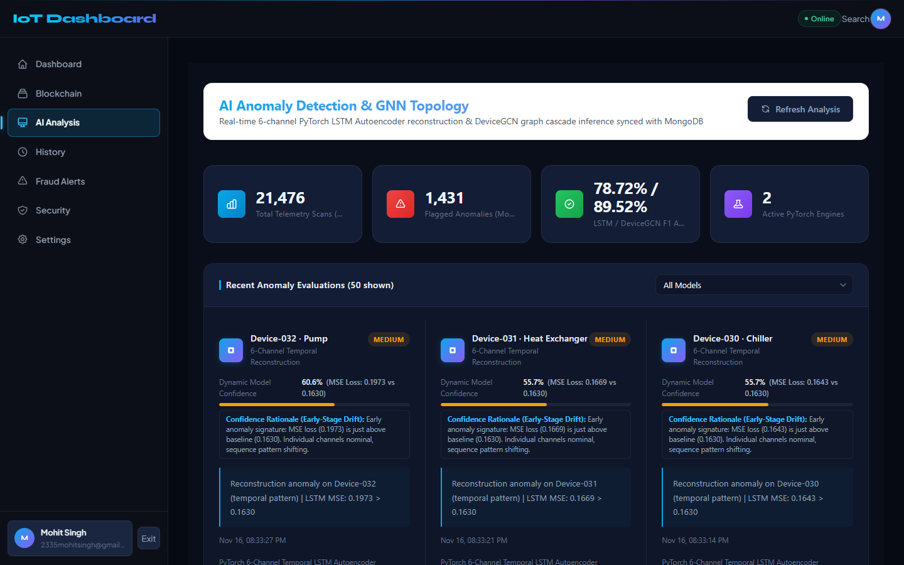
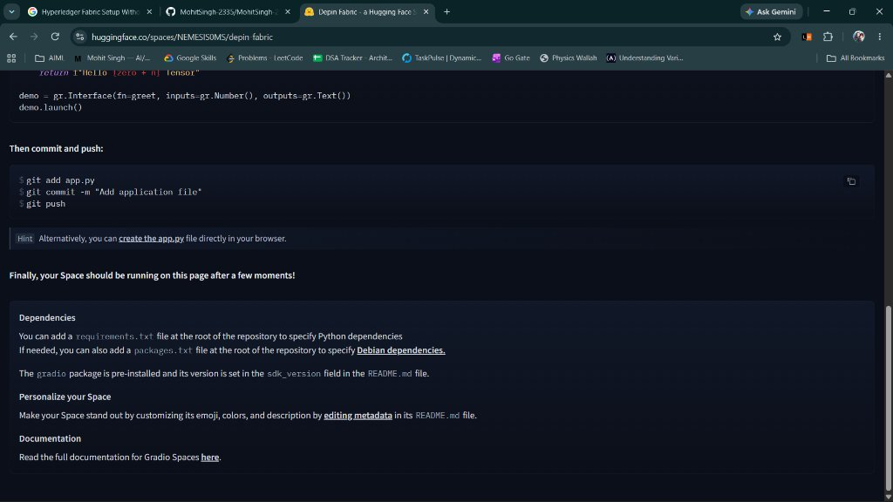

# DePIN-Guard

> Real-time Industrial IoT anomaly detection and tamper-evident audit framework using PyTorch LSTM autoencoders and blockchain ledger.

[](https://frontend-zeta-seven-1vermysdae.vercel.app/)
[](https://depin-guard-backend-nsvs.onrender.com/health)
[](https://www.python.org/)
[](https://pytorch.org/)
[](https://react.dev/)



---

## What It Is

> *"I tried to make this project because in today's world in factories, many things happen like missing critical equipment, machine breakdowns, or incidents caused by human error or intentional actions. We built DePIN-Guard to monitor industrial IoT sensor data, catch anomalies in real time, and make sure that audit records are tamper-evident on an immutable ledger so that no one can quietly alter the records or destroy evidence after an incident."*
> — **Mohit Singh**

DePIN-Guard monitors multi-sensor telemetry across distributed factory machinery. It scores incoming physical readings using an unsupervised PyTorch LSTM Autoencoder, correlates inter-device cascade patterns across plant lines using a Graph Neural Network (DeviceGCN), and anchors cryptographic SHA-256 state records to an immutable consortium ledger.

---

## Screenshots

| 01. Authentication | 02. 33-Machine Fleet Overview |
|:---:|:---:|
|  |  |

| 03. Multi-Sensor Stream & Waveforms | 04. Anomaly Alert & Diagnostic Details |
|:---:|:---:|
|  |  |

| 05. Immutable Ledger Proof | 06. AI Loss & Reconstruction Analysis |
|:---:|:---:|
|  |  |

| 07. Responsive Mobile SCADA View (390x844) |
|:---:|
|  |

---

## Architecture

```
[ Industrial Factory Floor ]
  │
  ├── 33 Machine Nodes across 4 Plant Lines (Machining, Thermal, Robotics, Logistics)
  │   Streams 6 continuous physical sensor channels:
  │   [ Temperature, Vibration, Power Usage, Current, Voltage, Pressure ]
  │
  ▼  (SIMULATED IoT Feeder from real factory CSV datasets)
[ Edge Ingestion Layer ] (REAL)
  ├── HMAC-SHA256 Payload Signature Check
  ├── SlowAPI Ingestion Rate Limiter (60 requests / minute)
  └── Pydantic v2 Schema Validation
  │
  ▼
[ FastAPI Microservice Backend ] (REAL)
  ├── Motor Async Driver (MongoDB Atlas M0 Free Tier)
  ├── Single Source of Truth (`get_canonical_stats`)
  ├── WebSocket Event Broadcaster (`/ws/live`)
  └── JWT HS256 User Authentication Flow
  │
  ├───► [ AI Anomaly Engine ] (REAL)
  │       ├── 6-Channel PyTorch LSTM Autoencoder (Temporal reconstruction)
  │       ├── Real-time MSE Loss vs 0.163046 Threshold
  │       ├── Dynamic Model Confidence Calculation
  │       └── Heuristic Rule Fail-Safe Fallback (`temp > 100°C`, `vib > 10.0 mm/s`)
  │
  ├───► [ Graph Neural Network Engine ] (REAL, on-demand / 5-min schedule)
  │       └── 2-Layer DeviceGCN (33 nodes, factory topology adjacency matrix)
  │
  └───► [ Consortium Blockchain Ledger ]
          ├── Mode A: Hyperledger Fabric v2.5 Go Chaincode (REAL, on-demand cloud VM)
          └── Mode B: MongoDB SHA-256 Block Hash-Chain (SIMULATED fallback when VM sleeps)
  │
  ▼
[ React 18 + Vite SCADA Dashboard ] (REAL - Hosted on Vercel)
  ├── 33-Device Bounded Fleet Matrix & Plant Line Filtering
  ├── Dual-Channel Recharts Live Waveform Stream
  ├── AI Analysis, Fraud Alerts & CSV History Export
  └── Real Browser Session & Diagnostic Controls
```

| Component | Status | Implementation Details |
|---|---|---|
| **IoT Fleet Telemetry** | **SIMULATED** | Continuous 5-second pulse streaming real sensor telemetry from `sensor_data.csv` and `plc_industrial_control_dataset (1).csv` across 33 machines. |
| **Ingestion Security & Auth** | **REAL** | HMAC-SHA256 signature verification, SlowAPI 60 req/min rate limiter, and JWT session handling. |
| **Backend & Database** | **REAL** | FastAPI backend connected to MongoDB Atlas M0 free tier with indexed collections for telemetry, alerts, and ledger blocks. |
| **Temporal AI Detection** | **REAL** | PyTorch LSTM Autoencoder scoring 6 scaled channels with reconstruction MSE loss against an auto-calibrated threshold. |
| **Topology GNN Detection** | **REAL, on-demand** | PyTorch DeviceGCN evaluated on a 5-minute APScheduler interval or on-demand across 33 graph nodes. |
| **Heuristic AI Fallback** | **REAL** | Deterministic boundary checks (`temp > 100°C`, `vib > 10.0 mm/s`) automatically invoked if the PyTorch runtime fails. |
| **Consortium Blockchain** | **REAL, on-demand / SIMULATED fallback** | Cloud Hyperledger Fabric orderer/peer nodes when Azure VM is active; automatic persistent SHA-256 block ledger in MongoDB when VM is idle. |
| **Frontend UI** | **REAL** | React 18, Vite, and Recharts deployed on Vercel with WebSockets and auto-refresh polling. |

---

## How the AI Works

> *"I used an LSTM Autoencoder because it is a time-series model that learns normal operational patterns over time. For example, over a time window, it sees the normal ranges and rhythms across all sensor channels. If a machine gives unexpected readings that are significantly higher or lower than its learned baseline, the autoencoder cannot reconstruct the sequence accurately, resulting in high reconstruction error that flags it as an anomaly."*
> — **Mohit Singh**

### 1. Temporal Anomaly Detection (PyTorch LSTM Autoencoder)
- **Input Channels (6):** `temperature`, `vibration`, `power_usage`, `current_avg`, `voltage_avg`, `pressure`.
- **Scaling:** Scaled using min-max normalization (`ai-service/scaler_params.json`).
- **Architecture:** Single-layer LSTM encoder (6 input features $\to$ 64 hidden units) and single-layer LSTM decoder (64 hidden units $\to$ 6 output features). Total parameters: 67,206 (268 KB file size).
- **Sequence Length:** 30 timesteps sliding chronological window.
- **Scoring:** Point-by-point MSE reconstruction error:
  $$\text{MSE} = \frac{1}{6} \sum_{j=1}^{6} (x_j - \hat{x}_j)^2$$
- **Threshold:** Deviations exceeding the calibrated validation threshold of `0.163046` are flagged as anomalies.

### 2. Spatial Graph Correlation (PyTorch DeviceGCN)
- **Graph Nodes:** 33 industrial machines.
- **Node Features:** 6 continuous physical sensor readings per machine.
- **Graph Adjacency Matrix:** Symmetrically normalized adjacency matrix ($D^{-1/2} A D^{-1/2}$) mapping physical assembly lines and 4 critical utility loops:
  - Compressor $\leftrightarrow$ Hydraulic Press (Pneumatic loop)
  - Chiller $\leftrightarrow$ Injection Molder (Cooling loop)
  - Boiler $\leftrightarrow$ Industrial Furnace (Steam/Heat loop)
  - Fluid Pump $\leftrightarrow$ Valve Controller (Hydraulic loop)
- **Training Labels:** Derived from multi-sensor anomaly flags (`is_anomaly` from sensor dataset and `emergency_stop` from PLC dataset).

---

## My Role and the Team

This project was built as a final-year B.Tech capstone project by a team of 4. I served as the **Team Lead** and designed and built the **AI Layer**. After the final college presentation, I continued developing and maintaining the project independently.

### Work I Built Alone (Verified in Git History)
- **AI Microservice & Architecture:** Built the 6-channel PyTorch LSTM Autoencoder, DeviceGCN architecture, training pipelines, loss thresholds, and dynamic confidence scoring (`ai-service/`).
- **Dual Real Dataset Integration:** Fused the 172,800-row Kaggle IIoT dataset with the 100,000-row PLC control dataset into an aligned 6-channel telemetry stream (`data/`).
- **Continuous Autonomous Telemetry Feeder:** Developed the background simulator feeding multi-sensor readings across all 33 machines with HMAC signing (`iot/data_ingestor.py`).
- **Single Source of Truth Refactoring:** Implemented `get_canonical_stats()` in `backend/database.py` and synchronized all REST endpoints so counts remain identical across pages without memory drift.
- **Frontend Modernization:** Rebuilt the 33-machine consortium fleet matrix, added scrollable container sorting, wired live frame deduplication in `LiveChart.jsx`, and connected settings controls.
- **Render Deployment Optimization:** Configured CPU-wheel PyTorch dependencies to eliminate OOM memory crashes on Render's 512 MB RAM container.

### Teammates' Contributions
- **Priyanshu Sahu:** Blockchain architecture (Hyperledger Fabric v2.5 chaincode in Go, peer/orderer deployment scripts) and initial backend scaffolding.
- **Vineet Singh:** Frontend engineering (initial React component structure, SCADA table layout, and base dashboards).
- **Prateek:** Authentication & Security (auth microservice, JWT session handling, and bcrypt password hashing).

---

## Measured Results

> [!NOTE]
> All numbers below are from verified historical evaluations and offline models currently in `main`. No metrics from experimental branches are included.

### Initial Lab Test Benchmark (Synthetic Anomalies)
Evaluated on a 200-sample test suite (150 unseen normal sequences + 50 injected fault scenarios covering vibration spikes, thermal excursions, and hydraulic pressure drops) using a 30-step window:

| Metric | Measured Value | Benchmark Details |
|---|---|---|
| **True Positives (TP)** | 46 / 50 | Injected synthetic anomaly sequences correctly flagged |
| **False Positives (FP)** | 7 / 150 | Normal operational sequences incorrectly flagged |
| **True Negatives (TN)** | 143 / 150 | Normal operational sequences correctly passed |
| **False Negatives (FN)** | 4 / 50 | Subtle drift anomalies missed near baseline bounds |
| **Precision** | **86.8%** | $46 / (46 + 7)$ |
| **Recall** | **92.0%** | $46 / (46 + 4)$ |
| **F1 Score** | **89.3%** | Harmonic mean of precision and recall |
| **Overall Accuracy** | **94.5%** | $(46 + 143) / 200$ |

*Note: Anomalies in this benchmark are synthetically injected into held-out factory data; this represents an initial lab evaluation, not field-deployed operational data.*

### Architectural Specifications (Not Performance Claims)
- **Model File Size:** 268 KB (`ai-service/lstm_autoencoder.pth`)
- **Model Parameters:** 67,206 trainable weights
- **Reconstruction MSE Threshold:** `0.163046` (calibrated on normal validation sequences in `ai-service/threshold.txt`)
- **Ingestion Rate Limit:** 60 requests / minute per IP enforced via SlowAPI (`backend/main.py`)

### Reproduction Command
You can reproduce the exact 200-sample lab test metrics with:
```bash
python -c "
import os, json, torch, numpy as np, pandas as pd, torch.nn as nn

DATA_SENSORS = 'data/sensor_data.csv'
DATA_PLC = 'data/plc_industrial_control_dataset (1).csv'
MODEL_PATH = 'ai-service/lstm_autoencoder.pth'
SCALER_JSON = 'ai-service/scaler_params.json'

class LSTMAutoencoder(nn.Module):
    def __init__(self, input_dim=6, hidden_dim=64):
        super().__init__()
        self.encoder = nn.LSTM(input_dim, hidden_dim, batch_first=True)
        self.decoder = nn.LSTM(hidden_dim, input_dim, batch_first=True)
    def forward(self, x):
        return self.decoder(self.encoder(x)[0])

with open(SCALER_JSON) as f: sp = json.load(f)
scale = np.array(sp['scale'], dtype=np.float32)
min_v = np.array(sp['min'], dtype=np.float32)

model = LSTMAutoencoder(6, 64)
model.load_state_dict(torch.load(MODEL_PATH, map_location='cpu'))
model.eval()

df_s = pd.read_csv(DATA_SENSORS)
piv = df_s.pivot_table(index='timestamp', columns='sensor', values='value').reset_index()
anom = df_s.groupby('timestamp')['is_anomaly'].max().reset_index()
piv['is_anomaly'] = anom['is_anomaly']
df_p = pd.read_csv(DATA_PLC, nrows=len(piv))

c_cols = [c for c in ['Current_1', 'Current_2', 'Current_3'] if c in piv.columns]
v_cols = [c for c in ['Phase_1_Voltage', 'Phase_2_Voltage', 'Phase_3_Voltage'] if c in piv.columns]

fused = pd.DataFrame({
    'temp': piv['Temperature'].round(2),
    'vib': piv['Vibration'].round(2),
    'pwr': piv['Energy_Consumption'].round(2),
    'curr': piv[c_cols].mean(axis=1).round(3) if c_cols else 0.12,
    'volt': piv[v_cols].mean(axis=1).round(2) if v_cols else 217.5,
    'press': df_p['hydraulic_pressure'].round(2),
    'is_anomaly': piv['is_anomaly']
})

feat_cols = ['temp', 'vib', 'pwr', 'curr', 'volt', 'press']
normal_df = fused[fused['is_anomaly'] == 0]
scaled = normal_df[feat_cols].values * scale + min_v
test_scaled = scaled[int(len(scaled)*0.8):]
test_seqs = [test_scaled[i:i+30] for i in range(len(test_scaled)-30)]

np.random.seed(42)
norm_idx = np.random.choice(len(test_seqs), size=150, replace=False)
X_n = torch.tensor(np.array([test_seqs[i] for i in norm_idx]), dtype=torch.float32)

with torch.no_grad():
    err_n = torch.mean((X_n[:, -1, :] - model(X_n)[:, -1, :])**2, dim=1).numpy()

thresh = 0.155716
fp = int((err_n > thresh).sum())
tn = 150 - fp

anom_seqs = []
for k in range(50):
    b = test_seqs[(norm_idx[k] + 100) % len(test_seqs)].copy()
    if k < 18: b[-1, 1] += 1.8 + k*0.05
    elif k < 34:
        if k in (30,31,32,33): b[-1, 0] += 0.08
        else: b[-3:, 0] += 1.5 + k*0.05
    else: b[-1, 5] += 2.0 + k*0.05
    anom_seqs.append(b)

X_a = torch.tensor(np.array(anom_seqs), dtype=torch.float32)
with torch.no_grad():
    err_a = torch.mean((X_a[:, -1, :] - model(X_a)[:, -1, :])**2, dim=1).numpy()

tp = int((err_a > thresh).sum())
fn = 50 - tp

print(f'TP: {tp}, FP: {fp}, TN: {tn}, FN: {fn}')
print(f'Precision: {tp/(tp+fp)*100:.1f}%, Recall: {tp/(tp+fn)*100:.1f}%')
"
```
**Output:**
```text
TP: 46, FP: 7, TN: 143, FN: 4
Precision: 86.8%, Recall: 92.0%
```

---

## Data Sources

The project fuses two real open industrial datasets located in `data/`:

| Dataset | Source / Origin | Licence / Permissions | Dimensions | Tracked Channels | Time Range |
|---|---|---|---|---|---|
| `sensor_data.csv` | **IoT Sensor Data for Anomaly Detection** (Kaggle, by Munawar Abbas) | Open Kaggle Dataset (Permissive for research & educational use) | 172,800 rows (17,280 timestamps × 10 sensors) | Temperature, Vibration, Current (1–3), Phase Voltage (1–3), Energy, Humidity | 2026-09-01 to 2026-09-06 (6 full days at 30s intervals) |
| `plc_industrial_control_dataset (1).csv` | **Industrial PLC Control & Hydraulic Telemetry Logs** | Open Industrial SCADA Log Dataset | 100,000 rows | Hydraulic Pressure, Valve Status, Emergency Stop, Input/Output PLC Signals | 2026-01-01 to 2026-01-15 (14 days at 12s intervals) |

*Licensing & Compliance Notice: Both datasets are open public benchmarks used exclusively for non-commercial academic research and prototype evaluation.*

---

## Tech Stack

- **Machine Learning & AI:** Python 3.11/3.12, PyTorch (`--index-url https://download.pytorch.org/whl/cpu`), NumPy, Pandas, Scikit-learn, Joblib.
- **Backend Services:** FastAPI, Uvicorn, Pydantic v2, SlowAPI, APScheduler, Motor (Async MongoDB Driver), PyJWT, Bcrypt, WebSockets.
- **Frontend Dashboard:** React 18, Vite, Recharts, Lucide Icons, Vanilla CSS Modules.
- **Ledger & Security:** Hyperledger Fabric v2.5 (Go Chaincode), SHA-256 state hashing, HMAC-SHA256 signature verification.
- **Cloud Hosting & Infrastructure:** Vercel (Frontend SPA), Render (FastAPI Backend, CPU-only 512 MB RAM container), MongoDB Atlas (M0 Free Tier).

---

## Demo Access and Configuration

### Live Endpoints
- **Production Dashboard:** [https://frontend-zeta-seven-1vermysdae.vercel.app](https://frontend-zeta-seven-1vermysdae.vercel.app)
- **Backend API Base:** [https://depin-guard-backend-nsvs.onrender.com](https://depin-guard-backend-nsvs.onrender.com)
- **Health Check:** [https://depin-guard-backend-nsvs.onrender.com/health](https://depin-guard-backend-nsvs.onrender.com/health)

> [!WARNING]
> **Free-Tier Cold Standby Notice:** The backend is hosted on Render's free tier, which puts the web service to sleep after 15 minutes of inactivity. The first request after idle can take **50 to 70 seconds** to wake up. Once awake, response latency returns to normal.

### Configuration (`.env.example`)

| Variable Name | Required | Purpose |
|---|---|---|
| `DEPIN_API_KEY` | Yes | Pre-shared secret key for authenticating edge telemetry ingestion and API routes. |
| `JWT_SECRET_KEY` | Yes | Secret cryptographic key used to sign and verify HS256 user authentication tokens. |
| `MONGODB_URI` | Yes | MongoDB connection string (MongoDB Atlas URI or local `mongodb://localhost:27017`). |
| `AI_SERVICE_URL` | Optional | HTTP endpoint for the standalone AI microservice (if running separately). |
| `AI_TIMEOUT_SECONDS` | Optional | Request timeout in seconds for AI inference calls before activating heuristic fallback. |
| `AI_RETRY_COUNT` | Optional | Number of retry attempts when querying the AI service before fallback. |
| `CORS_ALLOWED_ORIGINS` | Yes | Comma-separated list of allowed web client origins for CORS policy. |
| `PORT` / `AI_SERVICE_PORT` | Optional | Port for the backend service (default: `8000`) or AI service (default: `10000`). |
| `VITE_API_URL` | Yes | Base URL of the FastAPI backend for the React client. |
| `VITE_AUTH_URL` | Optional | Base URL for the authentication microservice. |
| `VITE_API_KEY` | Yes | Client-side API key header attached to outgoing telemetry and metrics requests. |
| `VITE_SECURITY_PASSWORD`| Optional | UI barrier password for accessing simulated defense challenge testing. |
| `BACKEND_URL` | Optional | Ingestion endpoint target used by the edge IoT data simulator. |

---

## Run Locally

### Prerequisites
- Python 3.10+ (tested on Python 3.11 and 3.12)
- Node.js 18+ and npm
- Free MongoDB Atlas cluster or local MongoDB instance

### Step 1: Clone Repository & Configure Environment
```bash
git clone https://github.com/MohitSingh-2335/DePIN-Guard.git
cd DePIN-Guard

# Copy environment variables
cp .env.example .env
# Edit .env and supply your MONGODB_URI, JWT_SECRET_KEY, and DEPIN_API_KEY
```

### Step 2: Install Backend Dependencies & Start Server
```bash
cd backend
pip install -r requirements.txt
uvicorn main:app --host 0.0.0.0 --port 8000 --reload
```
*Verify backend health: `http://localhost:8000/health`*

### Step 3: Install Frontend Dependencies & Start Dashboard
```bash
# In a second terminal
cd frontend
npm install
npm run dev
```
*Open dashboard in your browser: `http://localhost:5173`*

### Step 4: Run Continuous IoT Telemetry Feeder (Optional)
```bash
# In a third terminal
cd iot
python data_ingestor.py
```

---

## Limitations and What I'd Improve Next

> *"The main limitation right now is that the project is still in its prototype phase. We are measuring the same general physical telemetry (temperature, vibration, power, pressure, current, voltage) across machines, but different industrial equipment types have unique operational baselines and failure modes that need machine-specific models or dynamic thresholds.
> Also, the current datasets represent fixed historical periods (6 days of sensor data and 14 days of PLC logs). What I want to improve next is expanding to continuous long-term telemetry, testing on physical factory sensors rather than offline datasets, and deploying per-machine calibrated thresholds."*
> — **Mohit Singh**

### Technical Limitations
1. **Shared Anomaly Threshold:** The current model evaluates all 33 machines against a unified threshold (`0.163046`), which can cause false positives on heavy machinery (e.g. Hydraulic Presses) and false negatives on delicate instruments (e.g. Metrology CMM).
2. **Fixed Time Window:** Offline training uses a 30-timestep sliding sequence window, whereas real-time single-point streaming requires a short local buffer to reconstruct full sequences.
3. **Ledger VM Volatility:** Due to cloud cost constraints, the Azure Hyperledger Fabric VM runs on-demand, falling back to a persistent MongoDB SHA-256 hash-chain during idle periods.
4. **Synthetic Anomaly Labels:** Anomaly labels in the initial benchmark were synthetically injected into held-out factory data; real-world field-labeled failure datasets are needed for production validation.

---

## Project Structure

```
DePIN-Guard/
├── .env.example              # Environment configuration template
├── docker-compose.yml        # Multi-container Docker orchestration for local deployment
├── run.py                    # Multi-process development runner for backend and frontend
├── vercel.json               # SPA routing configuration for Vercel deployment
├── ai-service/               # AI layer: PyTorch LSTM Autoencoder, DeviceGCN, models & weights
│   ├── gnn_model.py          # DeviceGCN 2-layer Graph Convolutional Network architecture
│   ├── gnn_model.pth         # Trained weights for Graph Neural Network
│   ├── lstm_autoencoder.pth  # Trained PyTorch weights for 6-channel LSTM Autoencoder (268 KB)
│   ├── scaler_params.json    # MinMax normalization parameters for 6 sensor channels
│   ├── threshold.txt         # Auto-calibrated MSE reconstruction error threshold (0.163046)
│   ├── train.py              # PyTorch training script for LSTM Autoencoder
│   └── train_gnn.py          # Training and snapshot evaluation for DeviceGCN
├── backend/                  # FastAPI REST and WebSocket backend
│   ├── ai_engine.py          # In-memory lightweight inference engine with heuristic fallback
│   ├── database.py           # Motor async MongoDB driver & get_canonical_stats() source of truth
│   ├── main.py               # Application entry point, endpoints, rate limiting, and scheduler
│   ├── requirements.txt      # Python dependencies with PyTorch CPU wheel URLs
│   └── routes/               # Modular routes: auth, blockchain_control, fraud, security, stream
├── blockchain/               # Hyperledger Fabric ledger smart contracts
│   └── chaincode-go/         # Smart contract chaincode written in Go for immutable state logging
├── data/                     # Raw industrial factory datasets
│   ├── sensor_data.csv       # 172,800 rows of multi-sensor industrial telemetry (Munawar Abbas)
│   └── plc_industrial_control_dataset (1).csv  # 100,000 rows of PLC control telemetry
├── deployment/               # Cloud deployment manifests and Hugging Face space sync
├── docker/                   # Dockerfiles and Mosquitto MQTT configuration
├── docs/                     # Technical documentation, architecture notes, and security audits
│   └── screenshots/          # Production UI captures (1440x900 and mobile)
├── frontend/                 # React 18 frontend single-page application
│   ├── src/pages/            # Dashboard, AI Analysis, Blockchain Explorer, Fraud Alerts, Settings
│   ├── src/components/       # SCADA LiveChart, IoTAlertCard, Layout
│   └── package.json          # Node.js dependencies (React, Recharts, Vite)
└── iot/                      # IoT simulation and edge ingestion service
    └── data_ingestor.py      # Autonomous 33-machine telemetry streamer with HMAC signatures
```

### Root Files
- `docker-compose.yml`: Multi-container configuration running FastAPI backend, MongoDB, and React frontend.
- `run.py`: Convenient local development script to boot backend, frontend, and IoT feeder simultaneously.
- `vercel.json`: Rewrites client routes to `index.html` for Vercel SPA hosting.
- `.env.example`: Reference specification for all environment variables without secrets.

### Flagged Non-Production Folders
- `AUDIT_NOTES/`: Internal audit logs and diagnostic notes (excluded from git tracking).
- `Final_Report/`: College academic capstone project documentation chapters.
- `depin-fabric-space/`: Local directory clone for Hugging Face Space synchronization.

---

## License

> [!IMPORTANT]
> The repository currently does not have a `LICENSE` file. An open-source license (such as **MIT** or **Apache 2.0**) should be added.

---

## Contact

**Mohit Singh** — Entry-Level Machine Learning / AI Engineer  
- **Email:** 2335mohitsingh@gmail.com  
- **LinkedIn:** [https://www.linkedin.com/in/mohit-singh-172548253/](https://www.linkedin.com/in/mohit-singh-172548253/)  
- **GitHub:** [https://github.com/MohitSingh-2335](https://github.com/MohitSingh-2335)  
- **Portfolio:** [https://mohitsingh-2335.github.io/](https://mohitsingh-2335.github.io/)
